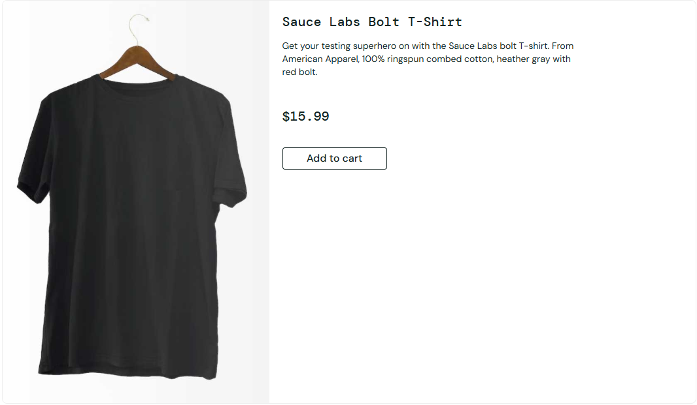
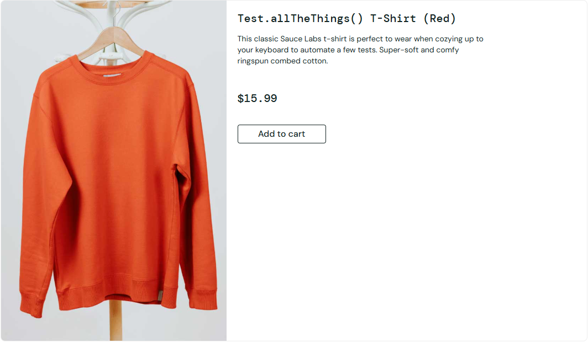

# BUG-001: Product Images Do Not Match Their Descriptions

## Bug Information

- **Bug ID:** BUG-001
- **Title:** Product images do not match their descriptions
- **Related Test Case:** TC-PROD-001
- **Application:** SauceDemo
- **Severity:** Medium
- **Status:** Open

## Environment

- **Operating System:** Windows
- **Browser:** Google Chrome
- **Test User:** standard_user

## Preconditions

- The SauceDemo application is accessible.
- The user is logged in with valid credentials.
- The Products page is displayed.

## Steps to Reproduce

1. Open the SauceDemo application.
2. Log in with `standard_user` credentials.
3. Navigate to the Products page.
4. Locate the Test.allTheThings() T-Shirt (Red) product.
5. Compare its description with the displayed image.
6. Locate the Sauce Labs Bolt T-Shirt product.
7. Compare its description with the displayed image.

## Expected Result

Each product should display an image that correctly matches its product description.

## Actual Result

Two product image and description inconsistencies were observed:

1. **Test.allTheThings() T-Shirt (Red):** The description refers to a classic Sauce Labs T-shirt, but the displayed image shows an orange sweatshirt-like garment with a crew neck and ribbed cuffs.

2. **Sauce Labs Bolt T-Shirt:** The description refers to a heather gray T-shirt with a red bolt, but the displayed image shows a plain black T-shirt.

## Evidence

**Screenshot 1 – Sauce Labs Bolt T-Shirt**

**Screenshot 2 – Test.allTheThings() T-Shirt (Red)**

## Impact

Users may have difficulty identifying products correctly because the displayed images do not match the product descriptions.
