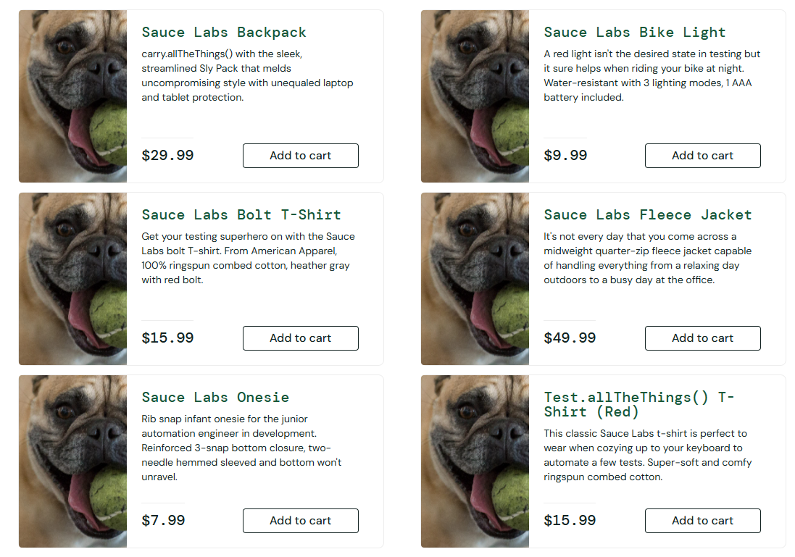

# BUG-002: Same Image Displayed for All Products

## Bug Information

- **Bug ID:** BUG-002
- **Title:** Same dog image is displayed for all products
- **Related Test Case:** TC-USER-001
- **Application:** SauceDemo
- **Severity:** Medium
- **Status:** Open

## Environment

- **Operating System:** Windows
- **Browser:** Google Chrome
- **Test User:** problem_user

## Preconditions

- The SauceDemo application is accessible.
- The user is logged in with problem_user credentials.
- The Products page is displayed.

## Steps to Reproduce

1. Open the SauceDemo application.
2. Log in with `problem_user` credentials.
3. Navigate to the Products page.
4. Observe the product images.

## Expected Result

Each product should display its corresponding product image.

## Actual Result

The same dog image is displayed for all products instead of their corresponding product images.

## Evidence

## Impact

Users cannot visually distinguish products because all products display the same image.
