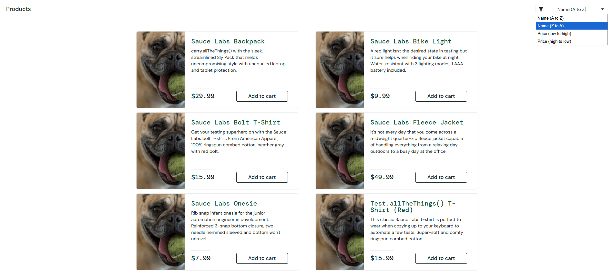

# BUG-003: Sorting Options Cannot Be Selected

## Bug Information

- **Bug ID:** BUG-003
- **Title:** Sorting options cannot be selected
- **Related Test Cases:** TC-USER-002, TC-USER-003
- **Application:** SauceDemo
- **Severity:** Medium
- **Status:** Open

## Environment

- **Operating System:** Windows
- **Browser:** Google Chrome
- **Test User:** problem_user

## Preconditions

- The SauceDemo application is accessible.
- The user is logged in with problem_user credentials.
- The Products page is displayed.

## Steps to Reproduce

1. Open the SauceDemo application.
2. Log in with `problem_user` credentials.
3. Navigate to the Products page.
4. Open the sorting dropdown menu.
5. Try to select Name (A to Z).
6. Try to select Name (Z to A).

## Expected Result

The user should be able to select sorting options, and products should be sorted alphabetically according to the selected option.

## Actual Result

The sorting dropdown menu opens and displays the available options, but none of the options can be selected.

## Evidence

## Impact

Users cannot change the product sorting order when logged in with the problem_user account.
