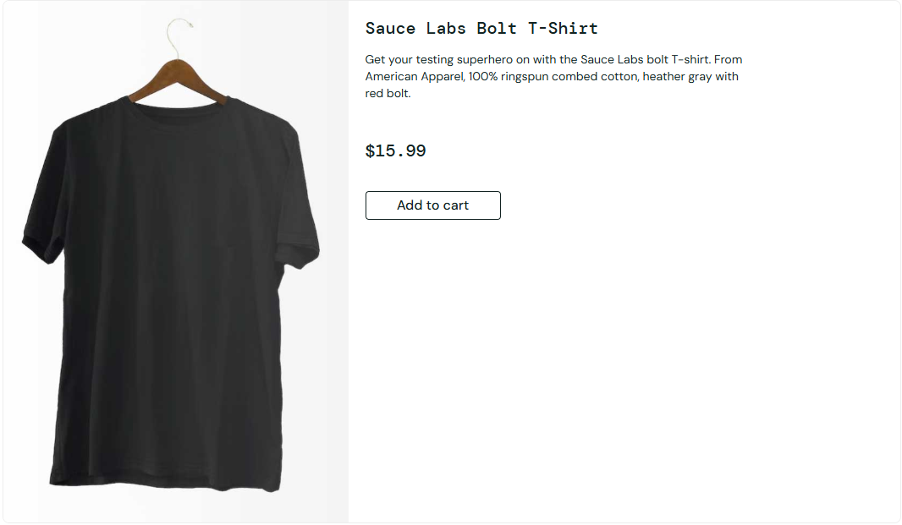
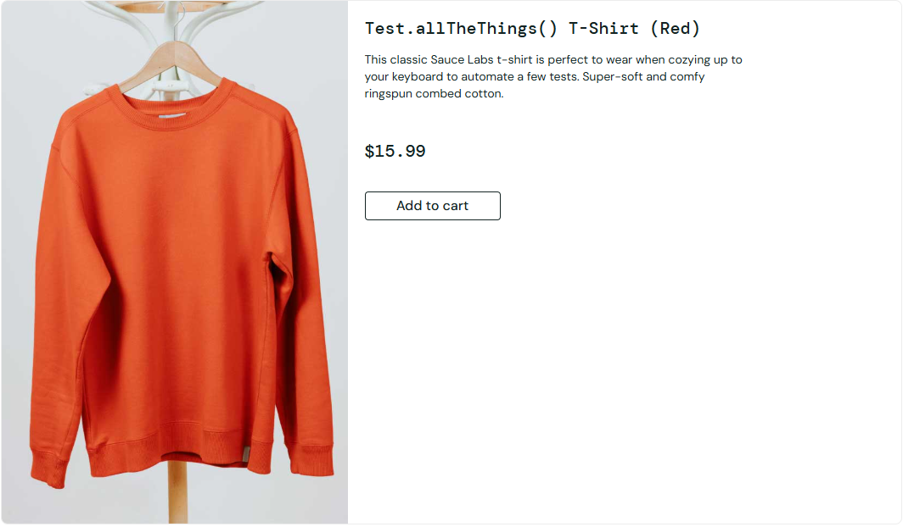
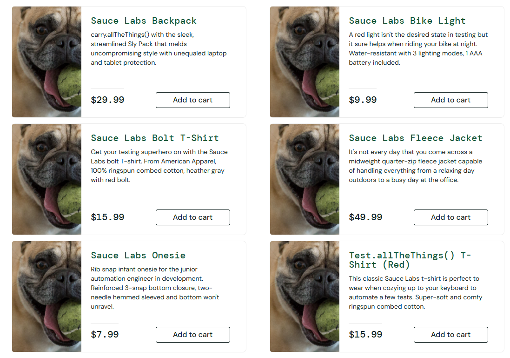
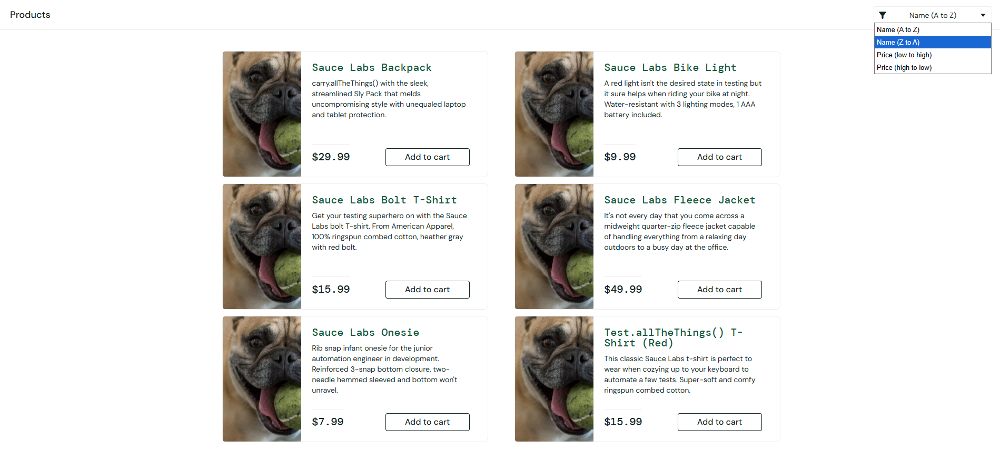

# Test Cases

## 1. Login Functionality

| Test Case ID | Test Scenario                | Test Steps                                                                                            | Test Data                       | Expected Result                                                                             |
| ------------ | ---------------------------- | ----------------------------------------------------------------------------------------------------- | ------------------------------- | ------------------------------------------------------------------------------------------- |
| TC-LOGIN-001 | Login with valid credentials | 1. Open the login page. 2. Enter a valid username and password. 3. Click the Login button.            | standard_user / secret_sauce    | User should be redirected to the Products page.                                             |
| TC-LOGIN-002 | Login with invalid password  | 1. Open the login page. 2. Enter a valid username and an invalid password. 3. Click the Login button. | standard_user / wrong_password  | An appropriate error message should be displayed.                                           |
| TC-LOGIN-003 | Login with invalid username  | 1. Open the login page. 2. Enter an invalid username and a valid password. 3. Click the Login button. | invalid_user / secret_sauce     | An appropriate error message should be displayed.                                           |
| TC-LOGIN-004 | Login with empty fields      | 1. Open the login page. 2. Leave both fields empty. 3. Click the Login button.                        | Empty username / Empty password | An error message indicating that the username is required should be displayed.              |
| TC-LOGIN-005 | Login with locked out user   | 1. Open the login page. 2. Enter the locked out user's credentials. 3. Click the Login button.        | locked_out_user / secret_sauce  | The user should not be able to log in and an appropriate error message should be displayed. |

### Test Execution Results

#### TC-LOGIN-001

**Test Result:** PASS

**Actual Result:** The user successfully logged in with valid credentials and was redirected to the Products page.

**Evidence:** Not required.

#### TC-LOGIN-002

**Test Result:** PASS

**Actual Result:** The user could not log in with an invalid password. The following error message was displayed: "Epic sadface: Username and password do not match any user in this service".

**Evidence:** Not required.

#### TC-LOGIN-003

**Test Result:** PASS

**Actual Result:** The user could not log in with an invalid username. The following error message was displayed: "Epic sadface: Username and password do not match any user in this service".

**Evidence:** Not required.

#### TC-LOGIN-004

**Test Result:** PASS

**Actual Result:** The user could not log in with empty username and password fields. The following error message was displayed: "Epic sadface: Username is required".

**Evidence:** Not required.

#### TC-LOGIN-005

**Test Result:** PASS

**Actual Result:** The user could not log in because the account was locked. The following error message was displayed: "Epic sadface: Sorry, this user has been locked out."

**Evidence:** Not required.

---

## 2. Product Listing and Sorting

| Test Case ID | Test Scenario                        | Test Steps                                                                                 | Test Data                    | Expected Result                                                                          |
| ------------ | ------------------------------------ | ------------------------------------------------------------------------------------------ | ---------------------------- | ---------------------------------------------------------------------------------------- |
| TC-PROD-001  | Verify product listing               | 1. Log in with valid credentials. 2. Observe the Products page.                            | standard_user / secret_sauce | Products should be displayed with their correct names, descriptions, prices, and images. |
| TC-PROD-002  | Sort products by name (A to Z)       | 1. Log in with valid credentials. 2. Select Name (A to Z) from the sorting dropdown.       | standard_user / secret_sauce | Products should be sorted alphabetically from A to Z.                                    |
| TC-PROD-003  | Sort products by name (Z to A)       | 1. Log in with valid credentials. 2. Select Name (Z to A) from the sorting dropdown.       | standard_user / secret_sauce | Products should be sorted alphabetically from Z to A.                                    |
| TC-PROD-004  | Sort products by price (low to high) | 1. Log in with valid credentials. 2. Select Price (low to high) from the sorting dropdown. | standard_user / secret_sauce | Products should be sorted from the lowest price to the highest price.                    |
| TC-PROD-005  | Sort products by price (high to low) | 1. Log in with valid credentials. 2. Select Price (high to low) from the sorting dropdown. | standard_user / secret_sauce | Products should be sorted from the highest price to the lowest price.                    |

### Test Execution Results

#### TC-PROD-001

**Test Result:** FAIL

**Actual Result:** Two product image and description inconsistencies were observed:

1. The Test.allTheThings() T-Shirt (Red) description referred to a classic Sauce Labs T-shirt, but the displayed image showed an orange sweatshirt-like garment with a crew neck and ribbed cuffs.
2. The Sauce Labs Bolt T-Shirt description referred to a heather gray T-shirt with a red bolt, but the displayed image showed a plain black T-shirt.

No clear inconsistencies were identified in the other products reviewed.

**Evidence:**

#### TC-PROD-002

**Test Result:** PASS

**Actual Result:** Products were successfully sorted alphabetically from A to Z.

**Evidence:** Not required.

#### TC-PROD-003

**Test Result:** PASS

**Actual Result:** Products were successfully sorted alphabetically from Z to A.

**Evidence:** Not required.

#### TC-PROD-004

**Test Result:** PASS

**Actual Result:** Products were successfully sorted from the lowest price to the highest price.

**Evidence:** Not required.

#### TC-PROD-005

**Test Result:** PASS

**Actual Result:** Products were successfully sorted from the highest price to the lowest price.

**Evidence:** Not required.

---

## 3. Shopping Cart Functionality

| Test Case ID | Test Scenario                           | Test Steps                                                                | Test Data                    | Expected Result                                                                  |
| ------------ | --------------------------------------- | ------------------------------------------------------------------------- | ---------------------------- | -------------------------------------------------------------------------------- |
| TC-CART-001  | Add a product to the cart               | 1. Log in with valid credentials. 2. Click Add to cart for a product.     | Sauce Labs Backpack          | The product should be added to the cart and the cart badge should display 1.     |
| TC-CART-002  | Remove a product from the Products page | 1. Add a product to the cart. 2. Click Remove.                            | Sauce Labs Backpack          | The product should be removed from the cart and the cart badge should disappear. |
| TC-CART-003  | Verify product details in the cart      | 1. Add a product to the cart. 2. Open the shopping cart.                  | Sauce Labs Backpack          | The cart should display the correct product name, description, and price.        |
| TC-CART-004  | Remove a product from the cart page     | 1. Add a product to the cart. 2. Open the shopping cart. 3. Click Remove. | Sauce Labs Backpack          | The product should be removed from the cart and should no longer be displayed.   |
| TC-CART-005  | Continue shopping from the cart page    | 1. Open the shopping cart. 2. Click Continue Shopping.                    | standard_user / secret_sauce | The user should be redirected to the Products page.                              |

### Test Execution Results

#### TC-CART-001

**Test Result:** PASS

**Actual Result:** The Sauce Labs Backpack was successfully added to the cart, and the cart badge displayed the number 1.

**Evidence:** Not required.

#### TC-CART-002

**Test Result:** PASS

**Actual Result:** The Sauce Labs Backpack was successfully removed from the cart, and the cart badge disappeared.

**Evidence:** Not required.

#### TC-CART-003

**Test Result:** PASS

**Actual Result:** The product name, description, and price displayed in the cart matched the information on the Products page.

**Evidence:** Not required.

#### TC-CART-004

**Test Result:** PASS

**Actual Result:** The Sauce Labs Backpack was successfully removed from the cart and was no longer displayed in the cart list.

**Evidence:** Not required.

#### TC-CART-005

**Test Result:** PASS

**Actual Result:** After clicking the Continue Shopping button, the user was successfully redirected to the Products page.

**Evidence:** Not required.

---

## 4. Checkout Functionality

| Test Case ID    | Test Scenario                            | Test Steps                                                                                                                        | Test Data                                            | Expected Result                                                                                      |
| --------------- | ---------------------------------------- | --------------------------------------------------------------------------------------------------------------------------------- | ---------------------------------------------------- | ---------------------------------------------------------------------------------------------------- |
| TC-CHECKOUT-001 | Proceed to checkout                      | 1. Log in with valid credentials. 2. Add a product to the cart. 3. Open the cart. 4. Click Checkout.                              | standard_user / secret_sauce                         | The user should be redirected to the checkout information page.                                      |
| TC-CHECKOUT-002 | Complete checkout with valid information | 1. Add a product to the cart. 2. Click Checkout. 3. Enter valid personal information. 4. Click Continue. 5. Click Finish.         | First Name: Test / Last Name: User / Zip Code: 06000 | The order should be completed successfully.                                                          |
| TC-CHECKOUT-003 | Continue checkout with empty fields      | 1. Add a product to the cart. 2. Click Checkout. 3. Leave all information fields empty. 4. Click Continue.                        | Empty fields                                         | An error message indicating that the first name is required should be displayed.                     |
| TC-CHECKOUT-004 | Verify checkout overview                 | 1. Add a product to the cart. 2. Proceed to checkout. 3. Enter valid information. 4. Click Continue. 5. Review the order summary. | Sauce Labs Backpack / Test / User / 06000            | The checkout overview should display the correct product details, item price, tax, and total amount. |
| TC-CHECKOUT-005 | Verify order confirmation                | 1. Complete the checkout process. 2. Click Finish. 3. Observe the confirmation page.                                              | standard_user / secret_sauce                         | The confirmation page should display "Thank you for your order!".                                    |

### Test Execution Results

#### TC-CHECKOUT-001

**Test Result:** PASS

**Actual Result:** The user was successfully redirected to the Checkout: Your Information page after clicking the Checkout button.

**Evidence:** Not required.

#### TC-CHECKOUT-002

**Test Result:** PASS

**Actual Result:** The user successfully completed the checkout process using valid information. The order confirmation page was displayed.

**Evidence:** Not required.

#### TC-CHECKOUT-003

**Test Result:** PASS

**Actual Result:** The user could not proceed with checkout when all fields were empty. The following error message was displayed: "Error: First Name is required".

**Evidence:** Not required.

#### TC-CHECKOUT-004

**Test Result:** PASS

**Actual Result:** The product information, item total, tax, and total amount were displayed correctly on the Checkout Overview page. The total amount matched the sum of the item total and tax.

**Evidence:** Not required.

#### TC-CHECKOUT-005

**Test Result:** PASS

**Actual Result:** The order was successfully completed, and the "Thank you for your order!" confirmation message was displayed.

**Evidence:** Not required.

---

## 5. User Account Behavior and Navigation

| Test Case ID | Test Scenario                        | Test Steps                                                                                      | Test Data                    | Expected Result                                                         |
| ------------ | ------------------------------------ | ----------------------------------------------------------------------------------------------- | ---------------------------- | ----------------------------------------------------------------------- |
| TC-USER-001  | Verify problem user product listing  | 1. Log in with problem user credentials. 2. Observe the product listing.                        | problem_user / secret_sauce  | Product names, descriptions, prices, and images should match correctly. |
| TC-USER-002  | Verify problem user sorting (A to Z) | 1. Log in with problem user credentials. 2. Select Name (A to Z). 3. Observe the product order. | problem_user / secret_sauce  | Products should be sorted alphabetically from A to Z.                   |
| TC-USER-003  | Verify problem user sorting (Z to A) | 1. Log in with problem user credentials. 2. Select Name (Z to A). 3. Observe the product order. | problem_user / secret_sauce  | Products should be sorted alphabetically from Z to A.                   |
| TC-USER-004  | Verify logout functionality          | 1. Log in with valid credentials. 2. Open the menu. 3. Click Logout.                            | standard_user / secret_sauce | The user should be redirected to the login page.                        |
| TC-USER-005  | Verify About menu navigation         | 1. Log in with valid credentials. 2. Open the menu. 3. Click About.                             | standard_user / secret_sauce | The user should be redirected to the Sauce Labs website.                |

### Test Execution Results

#### TC-USER-001

**Test Result:** FAIL

**Actual Result:** Product names, descriptions, and prices were displayed correctly. However, the same dog image was displayed for all products instead of their corresponding product images.

**Evidence:**

#### TC-USER-002

**Test Result:** FAIL

**Actual Result:** The sorting dropdown menu opens, but none of the sorting options can be selected.

**Expected Result:** Products should be sorted alphabetically from A to Z.

**Evidence:**

#### TC-USER-003

**Test Result:** FAIL

**Actual Result:** The sorting dropdown menu opens and displays the available options, but none of the options can be selected.

**Expected Result:** Products should be sorted alphabetically from Z to A.

**Evidence:**

#### TC-USER-004

**Test Result:** PASS

**Actual Result:** After clicking the Logout option, the user was successfully redirected to the login page.

**Expected Result:** The user should be redirected to the login page after logging out.

**Evidence:** Not required.

#### TC-USER-005

**Test Result:** PASS

**Actual Result:** After clicking the About option, the user was successfully redirected to the Sauce Labs website.

**Expected Result:** The user should be redirected to the Sauce Labs website.

**Evidence:** Not required.

---

## 6. Additional and Negative Test Scenarios

| Test Case ID | Test Scenario                             | Test Steps                                                                                                                                                                                     | Test Data                                             | Expected Result                                                                                            |
| ------------ | ----------------------------------------- | ---------------------------------------------------------------------------------------------------------------------------------------------------------------------------------------------- | ----------------------------------------------------- | ---------------------------------------------------------------------------------------------------------- |
| TC-NEG-001   | Checkout with missing last name           | 1. Add a product to the cart. 2. Proceed to checkout. 3. Enter a first name and postal code. 4. Leave the last name empty. 5. Click Continue.                                                  | First Name: Test / Last Name: Empty / Zip Code: 06000 | An error message indicating that the last name is required should be displayed.                            |
| TC-NEG-002   | Checkout with missing postal code         | 1. Add a product to the cart. 2. Proceed to checkout. 3. Enter a first name and last name. 4. Leave the postal code empty. 5. Click Continue.                                                  | First Name: Test / Last Name: User / Zip Code: Empty  | An error message indicating that the postal code is required should be displayed.                          |
| TC-CART-006  | Verify cart with multiple products        | 1. Log in with valid credentials. 2. Add multiple products to the cart. 3. Open the cart.                                                                                                      | Multiple products                                     | All selected products should be displayed correctly in the cart.                                           |
| TC-CART-007  | Verify empty shopping cart                | 1. Log in with valid credentials. 2. Add multiple products to the cart. 3. Open the shopping cart. 4. Remove all products.                                                                     | Multiple products                                     | No products should be displayed in the shopping cart.                                                      |
| TC-USER-006  | Verify performance glitch user navigation | 1. Log in with performance glitch user credentials. 2. Observe the page displayed after login. 3. If a product detail page appears, use the browser Back button. 4. Refresh the Products page. | performance_glitch_user / secret_sauce                | After navigating back to the Products page, refreshing the page should keep the user on the Products page. |

### Test Execution Results

#### TC-NEG-001

**Test Result:** PASS

**Actual Result:** The user could not proceed with checkout when the Last Name field was empty. The following error message was displayed: "Error: Last Name is required".

**Evidence:** Not required.

#### TC-NEG-002

**Test Result:** PASS

**Actual Result:** The user could not proceed with checkout when the Zip/Postal Code field was empty. The following error message was displayed: "Error: Postal Code is required".

**Evidence:** Not required.

#### TC-CART-006

**Test Result:** PASS

**Actual Result:** Both products were successfully added to the cart, and the cart badge displayed the number 2.

**Evidence:** Not required.

#### TC-CART-007

**Test Result:** PASS

**Actual Result:** All products were successfully removed from the cart. The cart was empty, and no products were displayed.

**Evidence:** Not required.

#### TC-USER-006

**Test Result:** PASS

**Actual Result:** The initial login took a long time, and a product detail page was displayed. After using the browser Back button to return to the Products page and refreshing the page, the user remained on the Products page.

**Expected Result:** After navigating back to the Products page, refreshing the page should keep the user on the Products page.

**Evidence:** Not required.

---

## 7. Boundary Value Test Scenarios

| Test Case ID    | Test Scenario                                   | Test Steps                                                                                                                              | Test Data                                  | Expected Result                                                               |
| --------------- | ----------------------------------------------- | --------------------------------------------------------------------------------------------------------------------------------------- | ------------------------------------------ | ----------------------------------------------------------------------------- |
| TC-BOUNDARY-001 | Verify checkout with minimum valid input length | 1. Add a product to the cart. 2. Proceed to checkout. 3. Enter the shortest non-empty values accepted by the fields. 4. Click Continue. | First Name: A / Last Name: B / Zip Code: 1 | The application should accept the input and proceed to the checkout overview. |

### Test Execution Results

#### TC-BOUNDARY-001

**Test Result:** PASS

**Actual Result:** The application accepted the minimum valid input values (First Name: A, Last Name: B, Zip Code: 1) and successfully redirected the user to the Checkout: Overview page.

**Expected Result:** The application should accept the input and proceed to the checkout overview.

**Evidence:** Not required.
